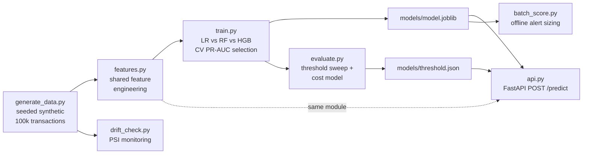

# Real-Time Fraud Detection System

An end-to-end machine-learning system that scores payment transactions
for fraud in real time: synthetic data generation → leakage-safe feature
engineering → model training & comparison → **cost-based threshold
selection** → a FastAPI inference service → batch scoring and drift
monitoring.

> **Data honesty note:** the dataset is **100 % synthetic**, produced by
> a seeded generator (`src/generate_data.py`, seed = 42) built for this
> portfolio. No real customer data is used. Fraud rows are injected with
> documented behavioural patterns (amount anomalies vs. the user's own
> history, night-time activity, channel/country changes, velocity
> bursts). Because synthetic patterns are cleaner than real-world fraud
> — real fraudsters actively adapt — the metrics below are best read as
> *system* results, not as a claim about production performance.

---

## 1. Problem statement & business framing

A card issuer processing 100k transactions with a **1.85 % fraud rate**
faces two asymmetric costs:

| Error | Consequence | Cost model used here |
|---|---|---|
| **False negative** (missed fraud) | The full transaction amount is lost | `cost = transaction amount` |
| **False positive** (legit txn flagged) | An analyst must review it; customer friction | `cost = $10 per review` |

On this project's held-out test set, doing nothing costs **$135,549**
(all fraud succeeds). A model is therefore not judged by accuracy —
with 98 % legitimate traffic, a model that approves everything is
98 % “accurate” and 100 % useless. The system is judged by
**precision/recall at a cost-minimising threshold**, with PR-AUC as the
headline ranking metric.

**Result:** the deployed configuration costs **$3,246** on the same
test set — **97.6 % cheaper than no model** — while catching
**95.7 %** of fraud.

## 2. Architecture



The dotted line is the important design decision: **training and the API
import the same `features.py` module**, eliminating train/serve skew by
construction.

## 3. Repository structure

```
fraud-detection/
├── README.md                  <- you are here
├── TALKING_POINTS.md          <- interview prep: pitch, numbers, Q&A
├── requirements.txt
├── data/transactions.csv      <- generated (100,000 rows)
├── models/
│   ├── model.joblib           <- best model + feature schema
│   └── threshold.json         <- cost-chosen operating threshold
├── outputs/
│   ├── training_metrics.txt       confusion_matrix.png
│   ├── evaluation_report.txt      precision_recall_curve.png
│   ├── test_predictions.csv       batch_score_summary.txt
│   └── drift_report.txt
├── src/
│   ├── generate_data.py       <- seeded synthetic data, causal features
│   ├── features.py            <- SHARED train/serve feature engineering
│   ├── train.py               <- 3 models, CV, saves best model
│   ├── evaluate.py            <- threshold sweep, cost model, plots
│   ├── api.py                 <- FastAPI inference service
│   ├── batch_score.py         <- offline scoring / alert sizing
│   └── drift_check.py         <- PSI drift monitoring
└── tests/
    ├── test_features.py       <- feature schema & behaviour (3 tests)
    └── test_model_smoke.py    <- model loads, API scorer logic (2 tests)
```

## 4. Setup & run

```bash
python -m venv .venv && source .venv/bin/activate
pip install -r requirements.txt

python src/generate_data.py   # -> data/transactions.csv
python src/train.py           # -> models/model.joblib, outputs/training_metrics.txt
python src/evaluate.py        # -> models/threshold.json, outputs/evaluation_report.txt
python src/batch_score.py     # -> outputs/batch_score_summary.txt
python src/drift_check.py     # -> outputs/drift_report.txt
python -m pytest tests/       # 5 tests (also runnable as plain scripts)

uvicorn src.api:app --port 8000   # serve the model
```

### Call the API

```bash
curl -X POST localhost:8000/predict \
  -H 'Content-Type: application/json' \
  -d '{"transaction_id":"txn_demo_fraud","timestamp":"2026-08-15 03:12:00",
       "user_id":"u10001","amount":940.0,"merchant_category":"electronics",
       "payment_channel":"online","device_type":"web_browser","country":"RU",
       "transactions_last_24h":8,"avg_amount_last_30d":48.0}'
```

Actual response captured from this system:

```json
{"transaction_id":"txn_demo_fraud","fraud_probability":1.0,"threshold":0.8,"decision":"flag","model":"logistic_regression"}
```

A normal grocery purchase ($42.50, chip, daytime, US) returns
`fraud_probability 0.0001, decision "approve"`.

## 5. Feature engineering (`src/features.py`)

| Feature | Idea |
|---|---|
| `log_amount` | log1p of amount — tames the long right tail |
| `amount_ratio_user`, `amount_dev_user` | amount vs. **the user's own** 30-day average — fraud is relative to the victim's habits, not to global averages |
| `velocity_24h`, `velocity_log` | transactions by this user in the prior 24 h |
| `hour_sin`, `hour_cos` | cyclical encoding — 23:00 and 01:00 are close in time, not 22 units apart |
| `is_night` | 00:00–05:59 flag |
| `amount_x_velocity` | interaction: large amount *and* high velocity |
| one-hots | merchant category, payment channel, device, country (unknown values → `OTHER`/all-zero, never a crash) |

The rolling inputs (`transactions_last_24h`, `avg_amount_last_30d`) are
computed **causally** in the generator — a transaction only sees its
user's *earlier* transactions — so there is no target leakage by
construction.

## 6. Results (real, from the run — seed 42)

Training: stratified 80/20 split; model selection by **3-fold CV
PR-AUC** on the training set; imbalance handled with
`class_weight='balanced'`.

| Model | CV PR-AUC | CV ROC-AUC | Test PR-AUC | Test ROC-AUC | Prec @0.5 | Rec @0.5 | F1 @0.5 |
|---|---|---|---|---|---|---|---|
| **Logistic Regression** ✅ | **0.9667** | 0.9976 | **0.9659** | **0.9984** | 0.555 | **0.970** | 0.706 |
| Random Forest | 0.9508 | 0.9964 | 0.9526 | 0.9980 | **0.914** | 0.889 | **0.901** |
| HistGradientBoosting | 0.9490 | 0.9966 | 0.9559 | 0.9980 | 0.684 | 0.951 | 0.796 |

**Selected: logistic regression** — because model selection used the
threshold-free ranking metric (CV PR-AUC). The random forest's better
F1 is an artefact of the arbitrary 0.50 default; once the operating
threshold is tuned (next section), ranking quality is what pays.
An interpretable linear model winning on engineered features is also a
genuinely common production outcome.

### Threshold / cost analysis (test set, logistic regression)

| | |
|---|---|
| Baseline cost (no model, all fraud missed) | $135,548.68 |
| **Chosen threshold (cost-minimising)** | **0.80** |
| Precision / Recall / F1 @ 0.80 | 0.748 / 0.957 / 0.840 |
| Confusion matrix @ 0.80 | TP 353 · FP 119 · TN 19,512 · FN 16 |
| **Total cost @ 0.80** | **$3,245.79 (−97.6 % vs. baseline)** |

Note the shape of the trade-off in the full sweep
(`outputs/evaluation_report.txt`): at threshold 0.05 recall is 99.7 %
but the team drowns in 1,967 false alerts ($19,670 review cost); at 0.95
review cost collapses but missed fraud climbs to $4,794. The optimum
sits in between — that balance *is* the fraud-ops job.

### Batch scoring (first 5,000 transactions)

106 alerts (2.12 % of traffic) at the 0.80 threshold, catching 87.5 %
of the fraud in that slice at 66.0 % alert precision — the workload
number a fraud-ops manager would staff against.

### Drift check (simulated new batch: amounts ×1.35, fraud rate 2.6 %)

| Signal | PSI | Verdict |
|---|---|---|
| `amount` | 0.181 | moderate shift — investigate |
| `transactions_last_24h` | 0.268 | significant shift — retrain / recalibrate |
| fraud rate | 1.85 % → 2.66 % | label drift — re-tune threshold on fresh labels |

## 7. Limitations

- **Synthetic data.** Injected fraud patterns are stationary and
  comparatively clean; real fraud is adversarial and adaptive, and
  real-world PR-AUC would be far lower. The pipeline, not the absolute
  metrics, is the deliverable.
- **Point-in-time features are simplified.** A production system would
  compute velocity/averages in a streaming feature store (and would
  need point-in-time joins to avoid leakage at training time).
- **Costs are illustrative.** The $10 review cost and “FN = amount”
  assumptions are stated explicitly so the threshold analysis can be
  re-run under any cost model.
- **No delayed-label handling.** In reality fraud labels arrive days
  or weeks later (chargebacks), which complicates evaluation timing.

## 8. Next steps

1. Point-in-time-correct training set + time-based split validation.
2. Streaming features (Kafka/Flink or Redis) and sub-100 ms scoring.
3. Champion/challenger deployment and per-segment thresholds.
4. Case-management feedback loop so analyst verdicts become labels.
5. Calibration check (Platt/isotonic) — a *probability* feeds the cost
   model, so it should mean what it says.

## 9. What I learned

- With a 1.85 % positive rate, **accuracy and ROC-AUC are vanity
  metrics**; PR-AUC and a priced confusion matrix tell the truth.
- **Model selection and threshold selection are different decisions** —
  pick the model on a threshold-free metric, then buy the operating
  point with an explicit cost model.
- Engineered, user-relative features let a simple logistic regression
  beat two tree ensembles — feature quality > model complexity.
- Sharing one feature module between training and serving removes an
  entire class of production bugs before it can happen.
- A model without a drift monitor is a model you *hope* still works.
